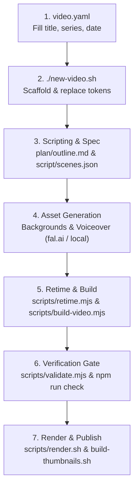

# AGENTS.md

Instructions and operating guidelines for AI coding agents (Claude Code, Antigravity, Cursor, Codex, Copilot, etc.) working in this video production repository.

---

## 1. Executive Overview & Architecture

This repository is an automated, code-driven video production workspace. It transforms structured scripts and specifications into finished 1080p MP4 videos using [Hyperframes](https://hyperframes.heygen.com) (HTML/CSS + GSAP seekable animation runtime).

### Single Source of Truth Hierarchy
1. **`video.yaml`**: Root identity metadata (`title`, `series`, `publish_date`, `slug`).
2. **`spec/project.json`**: Editorial brief, target audience, duration, tone, rules, risks, and acceptance criteria.
3. **`script/scenes.json`**: **The definitive structural source of truth**. Every scene, voiceover line, timing slot, overlay text, B-roll description, and background reference lives here.
4. **`spec/publish.json`**: YouTube delivery packaging (titles, description, chapters, tags, thumbnail pairing).
5. **`video/`**: The generated Hyperframes project. **Never edit `video/index.html` or `video/compositions/*.html` by hand.** Edit `script/scenes.json` or `scripts/build-video.mjs`, then regenerate.

---

## 2. Directory Layout & Agent Permissions

| Path | Purpose | Agent Edit Policy |
|---|---|---|
| `video.yaml` | Core project metadata | Edit once before running `./new-video.sh` |
| `script/scenes.json` | Scene data: vo, overlays, bg, timing | **Primary editable file** |
| `spec/project.json` | Video brief, rules, acceptance | **Primary editable file** |
| `spec/publish.json` | Publishing packaging & metadata | **Primary editable file** |
| `plan/outline.md` | Narrative structure & beats | Editable during planning |
| `plan/shot-list.md` | Required B-roll & footage checklist | Editable during planning |
| `checklists/*.md` | Pre-prod, production & release checklists | Tick boxes (`[x]`) as tasks complete |
| `prompts/` | Prompt templates for AI image/script tools | Editable |
| `presets/render.json` | Hyperframes render configurations | Editable for render flags |
| `presets/captions.md` | Caption rules & safe areas | Reference only |
| `thumbnails/*.html` | HTML-based thumbnail templates | Editable (all text MUST be HTML) |
| `scripts/*.mjs`, `*.sh` | Generators, validators & renderers | Maintain and improve |
| `video/package.json` | Pins the `hyperframes` CLI version | Only update version string deliberately |
| `video/compositions/` | Rendered HTML sub-compositions | **DO NOT EDIT DIRECTLY** (Generated) |
| `video/index.html` | Root composition mounting scenes | **DO NOT EDIT DIRECTLY** (Generated) |
| `video/assets/` | Media assets (`bg/`, `vo/`, `logos/`) | Git-ignored. Generate or link media |

---

## 3. Strict Workflow Rules for AI Agents

1. **No Secrets in Git**:
   - `FAL_KEY` and other credentials must only reside in `.env` (git-ignored).
   - Before completing any task, check diffs with `git grep -E "(key|secret|token|password)"` to ensure no keys leak.
2. **No Media Files in Git**:
   - `.gitignore` strictly blocks binary media (`*.mp4`, `*.mp3`, `*.jpg`, `*.png`, `*.wav`).
   - Store raw assets in `video/assets/` locally or download them on demand.
3. **Edit Sources, Not Generated Artifacts**:
   - Always modify `script/scenes.json`, `spec/project.json`, or the generator `scripts/build-video.mjs`.
   - Never manually alter HTML files under `video/` or `video/compositions/`.
4. **No Hallucinated Facts, Numbers, or Links**:
   - Never invent external URLs, metrics, prices, or quotes.
   - Use `<<TO CONFIRM>>` or ask the user when details are unknown.
5. **Deterministic Animations & Safe Areas**:
   - Do not use non-deterministic JavaScript (`Math.random()`, `Date.now()`) or dynamic network fetches at render time.
   - Captions and titles must always sit inside the 16:9 safe zone (minimum 60px padding from canvas edges).

---

## 4. End-to-End Production Lifecycle



### Phase 1: Initialize New Video
```bash
# Option A: Interactive Bulk Setup Panel (answers all project, brief, style & scene questions at once)
node scripts/init-panel.mjs
# Open http://localhost:4173 (or open panel/index.html directly in a browser)

# Option B: CLI Scaffolding
# 1. Edit video.yaml with title, series, and publish_date
# 2. Run new-video scaffolding (run once per video):
./new-video.sh <slug>
```

### Phase 2: Scripting & Planning
- Write high-level beats into `plan/outline.md`.
- Populate `script/scenes.json`:
  - `vo`: Conversational spoken text (target ~130 words per minute).
  - `overlay`: Headline (≤ 6 words) and concise bullet points (≤ 4 lines).
  - `bg`: Plate identifier declared in `prompts/backgrounds.json`.
  - `realAsset`: Description of real footage needed, or `null`.

### Phase 3: Assets & Voiceover
```bash
# Generate AI background plates from prompts/backgrounds.json:
scripts/gen-backgrounds.sh

# Generate voiceover audio and measure duration (requires FAL_KEY):
scripts/gen-voiceover.sh [bm_george|bm_lewis|bf_emma|bf_isabella]
# Note: gen-voiceover.sh automatically invokes scripts/retime.mjs!
```

### Phase 4: Build & Compositions
```bash
# Re-time scene durations to match measured voiceovers (if adjusted manually):
node scripts/retime.mjs

# Build HTML compositions from scenes.json:
node scripts/build-video.mjs          # Draft mode (includes draft indicator)
node scripts/build-video.mjs --final  # Final mode (clean production render)
```

### Phase 5: Verification & Testing
```bash
# Run fast pre-render validation:
node scripts/validate.mjs            # Warns on placeholders
node scripts/validate.mjs --strict   # Fails on any placeholder or missing asset

# Run Hyperframes engine integrity check:
cd video && npm run check

# Inspect specific visual timestamps before full render:
npx hyperframes snapshot --at 1,5,15
```

### Phase 6: Rendering & Packaging
```bash
# Render video:
scripts/render.sh draft   # Fast draft render for internal review
scripts/render.sh final   # High quality production render (strict validation)

# Render thumbnails:
scripts/build-thumbnails.sh

# Complete checklist:
# Check and tick items in checklists/release.md
```

---

## 5. Hyperframes Technical Render Contract

When modifying `scripts/build-video.mjs` or writing custom sub-compositions, you **must adhere to Hyperframes rules**:

1. **Timeline Registration**:
   Each composition must expose exactly one paused GSAP root timeline registered on `window.__timelines`:
   ```javascript
   window.__timelines = window.__timelines || {};
   window.__timelines["composition-id"] = gsap.timeline({ paused: true });
   ```
2. **Child Timelines**:
   Child timelines nested inside the root must **not** be paused (otherwise scrubbing/seeking fails).
3. **Timed Elements**:
   Every visual element that appears over time must have `class="clip"` and `data-start="<seconds>"` plus `data-duration="<seconds>"`.
4. **Media Elements**:
   - Silent background footage / B-roll: `<video muted playsinline ...>`.
   - Video with audio: `<video data-has-audio="true" ...>`.
   - Voiceover / BGM: Use `<audio>` elements.

---

## 6. Common Pitfalls & Solutions

| Issue | Cause | Fix |
|---|---|---|
| `validate.mjs: start is X, expected Y` | Scene durations were changed without updating starts | Run `node scripts/retime.mjs` |
| `missing video/assets/bg/<name>.jpg` | Background image not yet downloaded/generated | Run `scripts/gen-backgrounds.sh` or supply image |
| `missing video/assets/vo/<id>.mp3` | Voiceover not generated | Run `scripts/gen-voiceover.sh` or add audio to `assets/vo/` |
| `npm run check` fails on clip bounding | Timed element missing `.clip` class or CSS sizing | Ensure container has `class="clip"` and fixed width/height |
| Placeholders remain in output | Leftover `<<...>>` tokens | Fill in required fields; `--strict` validator blocks them |
| Chrome binary not found on Linux | `build-thumbnails.sh` default path is macOS | Set `export CHROME=$(which google-chrome || which chromium)` |

---

## 7. Instructions for Subagents & Collaborating Agents

- **Script Writer Agent**: Focuses on `plan/outline.md` and `script/scenes.json`. Enforces concise, natural phrasing, 130 WPM cadence, single call-to-action in final scene.
- **Visual & Style Agent**: Focuses on `prompts/backgrounds.json`, CSS layouts in `build-video.mjs`, and thumbnail designs in `thumbnails/*.html`.
- **QA & Verification Agent**: Runs `node scripts/validate.mjs --strict`, `cd video && npm run check`, captures snapshots, and verifies audio sync and safe areas.

---

## 8. Keynote Style, Music Bed & Review Workflow (v1.2.0+)

### Keynote Style (`"style": "keynote"` in `script/scenes.json`)
- Each scene defines a `keynote` array of beats: `{ "at": "<words in VO>", "text": "...", "key": "<accent word>" }`, plus optional `"image": "<bg name>"` or `"visual": "<knVisual name>"` (22 built-in animated SVGs, no text/logos inside drawings).
- Rules: max 6 words per beat, no lists, one accent word, 140–200 px type on black.
- Word-accurate timing: if `video/assets/vo/<id>.transcript.json` exists (Whisper word timestamps), `scripts/build-video.mjs` aligns beats via LCS; otherwise it estimates from word position.
- Run `node scripts/audit-keynote.mjs --label=vN [--mp4=draft/vN/video.mp4]` to verify 0 flagged moments.

### Music Bed (`scripts/gen-music.sh` + `scripts/mix-music.mjs`)
- `scripts/gen-music.sh` generates an instrumental ACE-Step bed (`video/assets/music/bed-raw.*`, Apache-2.0) via `fal.ai`.
- `node scripts/mix-music.mjs` ducks the bed under voiceover clips and swells in gaps/CTA (`video/assets/music/bed-mix.mp3`), which `scripts/build-video.mjs` auto-mounts.

### Timed Draft Renders & Review Server (`scripts/render-draft.mjs`, `server.mjs`)
- `node scripts/render-draft.mjs [--version=N]` runs build → `npm run check` → 1080p render → 720p web copy → scene frames → records timings in `spec/performance.json` → rebuilds `review.html`, `compare-drafts.html`, `first-draft.html`, `renders.html`, and `performance.html`.
- `node server.mjs` serves the workspace locally (default port `30080` or `PORT`) with HTTP 206 range seeking for MP4 scrubbing, automatic draft video fallback, dotfile blocking (`.env`, `.git`, `.hyperframes`), and optional server-proxy Azure Blob sync for review drawings and verification state.

